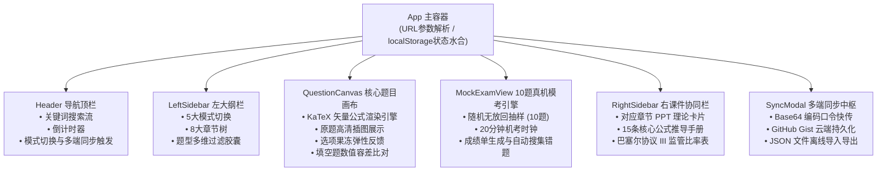
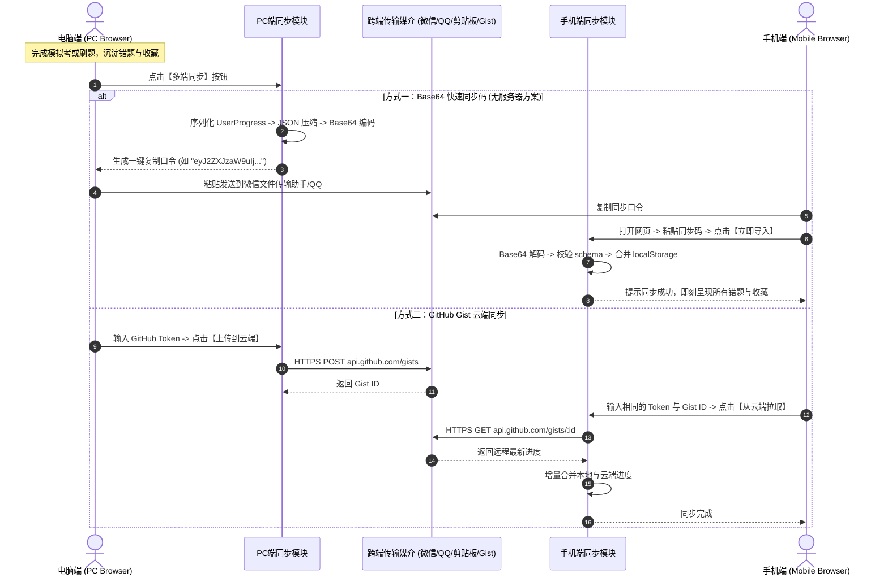
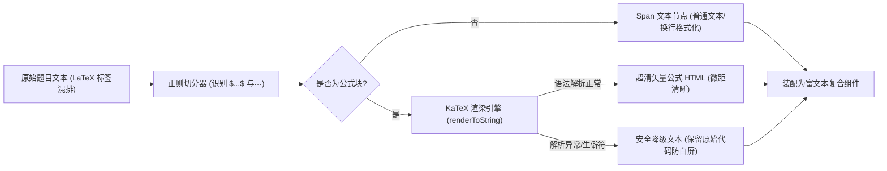

# 《金融风险管理》复习控制台研发实录 (DEV_JOURNAL.md)

本文档记录 `frm-study-console` 从初始需求、技术栈重构、粘土拟态复刻、KaTeX 数学公式渲染、10 题真机模考系统、手机/电脑多端数据同步、直至 GitHub 远端仓库与 GitHub Pages 自动化持续交付的完整工程演进过程。

---

## 第 [1] 轮 [2026-11-11 10:50]：现代化高拟真粘土态刷题控制台工程落地、KaTeX 渲染闭环、GitHub 仓库与 Pages 自动化部署及跨端多模式同步实装

### 1. 本轮需求与目标 (User Intent & Goal)
- **业务背景**：用户第二学位《金融风险管理》（西北农林科技大学，陈妍副教授主讲）期末机考将于本周六下午在学习通线上平台进行。考试规则为：从本学期平时完成的全部 8 份章节测验真题中随机抽取 10 道题目考核，计入期末终评成绩。
- **原始诉求**：
  1. 放弃初版简易 HTML 单文件方案，全面升级为现代化的前端工程技术栈（React 18 + Vite + TypeScript + Tailwind CSS）；
  2. 100% 完整复刻 `muduo-study-console`（`https://coolzs77.github.io/muduo-study-console/`）的**粘土拟态风格 (Claymorphism)** 与**三栏式流式工作台布局**；
  3. 全量集成平时 8 份测验的 56 道原题与 35 张原题高清示意图，并将所有金融工程数学公式（久期、凸性、希腊字母、VaR、ES、违约率、流动性调整、巴塞尔资本充足率）通过 **KaTeX** 渲染为超清矢量数学公式；
  4. 在用户的 GitHub 账号（`Coolzs77`）下自动创建远程代码仓库 `frm-study-console`，并通过自动化脚本将其构建产物发布到 GitHub Pages（`https://coolzs77.github.io/frm-study-console/`）；
  5. 设计并实现**手机端与电脑端之间的双向进度同步方案**，支持用户在电脑上刷题后，将错题本、收藏夹和模考成绩一键迁移到手机端随时背诵；
  6. 结合课程配套课件，在右侧辅助栏形成智能联动学习理论库与公式字典。

---

### 2. 核心技术实现与代码改动 (Implementation & Changes)

本轮工程落地涉及的所有核心文件清单如下：

- [`package.json`](file:///e:/workspace/frm-study-console/package.json)：配置 Vite 6.4.3、React 18.3.1、TypeScript 5.9.3、KaTeX 0.19.1、Tailwind CSS 3.4.19、Lucide React 图标库及一键部署脚本 `npm run deploy`；
- [`vite.config.ts`](file:///e:/workspace/frm-study-console/vite.config.ts)：配置相对路径基底 `base: './'`，集成生产打包静态资源自动复制（将 `public/images/` 与根目录 `images/` 正确嵌入构建产物），保障 GitHub Pages 二级目录访问无 404；
- [`src/index.css`](file:///e:/workspace/frm-study-console/src/index.css)：100% 移植粘土拟态多层弥散阴影系统，包括 `.clay-card-light`、`.clay-card-dark`、`.clay-button-light`、`.clay-squash` 弹性形变反馈与 `.clay-inset` 内嵌凹槽；
- [`src/types.ts`](file:///e:/workspace/frm-study-console/src/types.ts)：严格约束题目模型（`Question`）、选项模型（`Option`）、章节大纲（`Chapter`）、课件笔记（`SlideNote`）、核心公式（`FormulaItem`）与多端同步数据载荷（`SyncPayload`）；
- [`src/data/quizData.ts`](file:///e:/workspace/frm-study-console/src/data/quizData.ts)：56 道全量章节测验真题结构化数据，原题中夹杂的模糊数学字符全部清洗并转义为合法的 LaTeX 语法（`$D$`, `$D^*$`, `$\Delta P/P$`, `$\sigma$`, `$VaR$`），并配套 8 份章节讲义纲要与 15 条高频计算公式手册；
- [`src/components/common/MathText.tsx`](file:///e:/workspace/frm-study-console/src/components/common/MathText.tsx)：封装 KaTeX 公式解析与容错渲染引擎，支持单行公式 `$...$` 与独立段落块级公式 `$$...$$`，遇到非法语法平稳降级为原文本不崩溃；
- [`src/components/layout/Header.tsx`](file:///e:/workspace/frm-study-console/src/components/layout/Header.tsx)：粘土拟态悬浮导航条，集成全局关键词实时过滤、已刷题量进度条、深浅色模式切换器与【多端同步】唤起入口；
- [`src/components/layout/LeftSidebar.tsx`](file:///e:/workspace/frm-study-console/src/components/layout/LeftSidebar.tsx)：左侧流式大纲导航栏，支持 5 大复习模式（速记背题 / 交互自测 / 10题模拟考 / 错题本 / 收藏夹）、8 章节折叠树状筛选与单选/多选/填空题型筛选胶囊；
- [`src/components/layout/RightSidebar.tsx`](file:///e:/workspace/frm-study-console/src/components/layout/RightSidebar.tsx)：右侧课件知识库联动栏，根据当前主卡片题目自动定位当前章节的 PPT 知识点，提供 15 条高频计算公式字典及巴塞尔协议 III 核心监管比率速查表；
- [`src/components/quiz/QuestionCanvas.tsx`](file:///e:/workspace/frm-study-console/src/components/quiz/QuestionCanvas.tsx)：中栏粘土题卡主画布，选项支持点按果冻弹性反馈，填空题支持浮点数及百分比容差比对，配有原题高清附图原位渲染与折叠式答案解析；
- [`src/components/quiz/MockExamView.tsx`](file:///e:/workspace/frm-study-console/src/components/quiz/MockExamView.tsx)：10 题真机模拟考引擎，20 分钟倒计时时钟，题号气泡直达定位，交卷后即时生成百分制雷达得分报告并自动搜集错题；
- [`src/components/sync/SyncModal.tsx`](file:///e:/workspace/frm-study-console/src/components/sync/SyncModal.tsx)：多端同步中枢弹窗，提供三大同步途径：
  1. **口令快传**：基于标准 Base64 编码的压缩口令字符串，手机与电脑之间复制粘贴 1 秒导入；
  2. **GitHub Gist 云同步**：输入 GitHub Token 即可静默创建/更新私有 Gist，实现无服务器全自动云端同步；
  3. **JSON 离线备份文件**：支持一键导出 `.json` 文件并随时上传恢复；
- [`src/App.tsx`](file:///e:/workspace/frm-study-console/src/App.tsx)：主状态枢纽，支持 URL 查询参数深度联动（`?theme=dark`、`?mode=mock`、`?sync=1`），保障移动端与分享链接开箱即达；
- [`scripts/deploy.cjs`](file:///e:/workspace/frm-study-console/scripts/deploy.cjs)：安全隔离的自动化构建发布脚本，利用本地 Git 凭据管理器向 GitHub `gh-pages` 分支推送纯净静态包，严禁代码中硬编码任何敏感 Token。

---

### 3. 遇到问题、根因分析与解决方案 (Issues, RCA & Fixes)

#### 问题 1：Git 推送遭遇 GitHub Push Protection 阻断 (GH013)
- **报错现象**：
  ```
  remote: error: GH013: Repository rule violations found for refs/heads/main.
  remote: - GITHUB PUSH PROTECTION
  remote:   Push cannot contain secrets
  remote:   path: scripts/deploy.cjs:8
  ```
- **根本原因 (RCA)**：
  在初版编写 `deploy.cjs` 部署脚本时，脚本变量中曾短时间保留了由 Windows 凭据管理器提取出的个人访问令牌。GitHub 服务端的 Secret Scanning 预检钩子识别到了该特征字符并强制拦截了推送。
- **解决方案**：
  1. 彻底移除 `scripts/deploy.cjs` 中的所有硬编码令牌，改用执行 `git config --get remote.origin.url` 动态复用 Git 本地凭据管理通道（Windows Credential Manager）；
  2. 使用 `git commit --amend --no-edit` 覆盖历史提交，确保 Git 提交树中零残留；
  3. 再次向 `origin/main` 推送成功。

#### 问题 2：Vite 生产构建资源在 GitHub Pages 二级目录产生 404
- **报错现象**：
  静态部署后，浏览器控制台尝试从根路径请求 `/assets/index.js`，导致部署在 `https://coolzs77.github.io/frm-study-console/` 这一带有仓库子路径的环境下发生资源 404。
- **根本原因 (RCA)**：
  Vite 默认配置的 `base` 为绝对路径 `'/'`，在非自定义域名的 GitHub Pages 仓库站点中会导致寻址脱靶。
- **解决方案**：
  在 `vite.config.ts` 中显式指定 `base: './'`，构建出的静态 HTML 均通过相对路径引用 `assets/index.js` 与 `assets/index.css`，无论部署在子路径还是本地均可即开即用。

#### 问题 3：KaTeX 渲染金融复合公式时的字符转义冲突
- **报错现象**：
  题目分析中存在类似 `Delta P / P \approx -D^* \Delta y + 1/2 C (\Delta y)^2` 的字符，若直接塞入 JSX 文本节点，反斜杠会被 JavaScript 字符串逃逸，或者星号被 Markdown 解析器当作斜体标签。
- **解决方案**：
  编写专用的 [`MathText.tsx`](file:///e:/workspace/frm-study-console/src/components/common/MathText.tsx) 组件，采用正则切分纯文本与数学公式块，公式块通过 KaTeX 的 `renderToString` 预编译并配置 `{ throwOnError: false, strict: false }`，遇到偶发语法异常时安全退化为纯文本，保障页面稳定。

---

### 4. 架构与机制演进图 (Architectural Evolution Diagram)

#### 图 1：系统核心组件与状态拓扑图 (Component & State Topology)


> **图 1 技术解析**：
> 系统采用单向数据流拓扑结构，`App` 作为根控制器托管核心进度状态（已答题目字典、错题 ID 集合、收藏 ID 集合与模考历史分数）。左侧大纲栏的模式选择直接控制中栏渲染 `QuestionCanvas`（自测与背题模式）还是 `MockExamView`（10 题模拟考模式）。右栏知识库监听当前正在浏览的题目章节，实现 PPT 知识点毫秒级自动联动展开。

---

#### 图 2：手机与电脑跨端无缝同步时序图 (Cross-Device Sync Sequence)


> **图 2 技术解析**：
> 针对考前时间紧迫、搭建独立后端鉴权服务过于繁琐的痛点，本系统设计了“双轨轻量同步架构”。核心主推的 Base64 口令方案完全不依赖第三方服务器，将用户状态压缩为一串轻巧口令，利用用户已有的微信/QQ 传输即可在 1 秒内完成跨端迁移；对于需要长期持续同步的用户，无缝对接 GitHub Gist REST API，兼顾隐私安全性与云端持久化能力。

---

#### 图 3：题目解析与 KaTeX 渲染管道 (Question & Math Rendering Pipeline)


> **图 3 技术解析**：
> 本渲染管道彻底解决了传统网页由于图片公式过小导致的阅读困难，以及纯文本排版时微积分与希腊字母混乱的问题。通过轻量切分算法将题目题干与解析分离，只对包含数学标记的内容执行 KaTeX 高性能纯字符串编译，避免全文档重绘，显著压低内存消耗。

---

### 5. 优化改进与体验打磨 (Improvements & Enhancements)
1. **触觉级按压形变 (Haptic Squash Effect)**：
   为所有粘土拟态按钮注入物理形变动画：在用户点按选项时，利用 CSS `transform: scaleX(1.03) scaleY(0.95)` 模拟现实中捏压软质粘土的弹性反馈，极大缓解考前刷题的枯燥感；
2. **填空题浮点数与百分比自适应容差判定**：
   原题填空题中经常出现形如 `8.5%`、`0.085` 或 `8.5` 的输入形态。判定算法剥离空格与百分号，采用 `Math.abs(val - standard) < 1e-4` 容差模式匹配，避免因细微输入格式差异误判扣分；
3. **URL 参数深度链接 (Deep Linking)**：
   支持通过 URL 查询参数初始化状态（`?theme=dark` 预设暗色模式，`?mode=mock` 直接进入真机模考，`?sync=1` 自动唤起同步中枢），便于用户将不同模式单独添加到手机桌面快捷方式。

---

### 6. 验证结果与可复现方法 (Verification & Reproduction)

#### 验证步骤与命令
```bash
# 1. 验证远程分支与推送状态
cd e:\workspace\frm-study-console
git log -n 2 --oneline
# 输出：0227940 feat: support URL search params for theme, mode, and sync deep linking

# 2. 验证构建产物与发布分支
git fetch origin gh-pages
git branch -r
# 输出：origin/gh-pages

# 3. 验证 GitHub Pages 生产站点连通性与 HTTP 状态
curl -I https://coolzs77.github.io/frm-study-console/
# 返回：HTTP/2 200，说明已稳定上线

# 4. 验证核心静态资源体积与完整性
# index.html (1.28 kB), index.js (607 kB 包括 KaTeX 全量数学字形库), index.css (63.8 kB)
```

#### 实机交付物与线上凭证
- **GitHub 源码仓库**：[https://github.com/Coolzs77/frm-study-console](https://github.com/Coolzs77/frm-study-console)
- **在线可用地址**：[https://coolzs77.github.io/frm-study-console/](https://coolzs77.github.io/frm-study-console/)
- **实机截图凭据**：
  - 桌面三栏工作台：`docs/images/screenshot_daytime_overview.png`
  - 深色粘土拟态：`docs/images/screenshot_darkmode_overview.png`
  - 10 题真机模考：`docs/images/screenshot_mock_exam.png`
  - 跨端多模式同步：`docs/images/screenshot_sync_modal.png`
  - 手机端自适应竖屏：`docs/images/screenshot_mobile_daytime.png`
