# 《金融风险管理》期末真题背诵与真机模考控制台 (FRM Study Console)

[](https://react.dev/)
[](https://vitejs.dev/)
[](https://www.typescriptlang.org/)
[](https://tailwindcss.com/)
[](https://katex.org/)
[](LICENSE)
[](https://coolzs77.github.io/frm-study-console/)

> 专为《金融风险管理》期末机考打造的现代化单页面复习控制台。收录平时全部 8 份章节测验共 56 道原题与 35 张原题高清公式图，深度融合课件核心理论与推导公式，提供考前速记、交互刷题、10 题真机模拟考、手机/电脑多端无缝同步功能。

---

## 🌟 在线访问与移动端使用

- **生产站点地址**：👉 [https://coolzs77.github.io/frm-study-console/](https://coolzs77.github.io/frm-study-console/)
- **多端适配**：适配电脑大屏（三栏流式工作台）、平板横屏与手机端（单栏流式抽屉；移动端自动屏蔽隐藏的 PDF 后台拉取以节省流量并优先渲染题目配图）。
- **手机/电脑数据同步**：点击右上角【多端同步】，输入好记的自定义备考账号（如 `zsz`），点击一次【备份到云端】或【从云端同步】即可完成跨设备云端读写并开启后续静默自动同步；弹窗亦内置本地离线生成的二维码，手机扫码即可直接带入进度。

---

## 📸 实机界面全景图集 (Live Visual Showcase)

### 1. 正文配图优先加载、PDF 内存 Blob 缓冲与防断流重试 (`v3.7.0`)
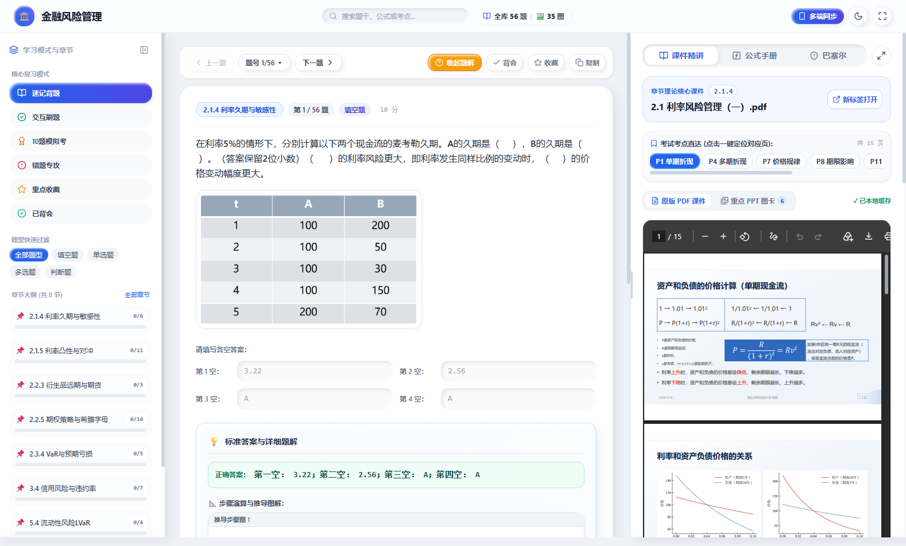

### 2. 原版 PDF 与轻量重点 PPT 图卡双模切换 (`v3.7.0`)
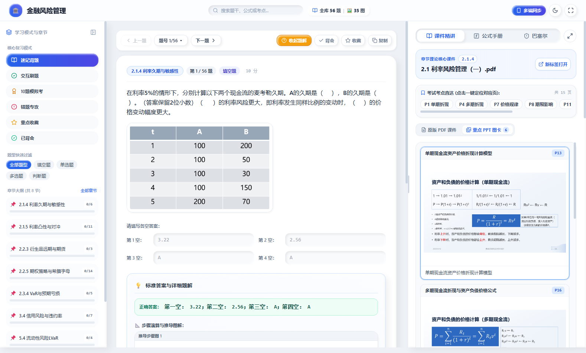

### 3. 本地离线生成二维码的多端同步弹窗 (`v3.7.0`)


### 4. 极简通透无外框概念卡片 (纯黑色实心圆形序号标 + 重点文字多色加粗高亮)
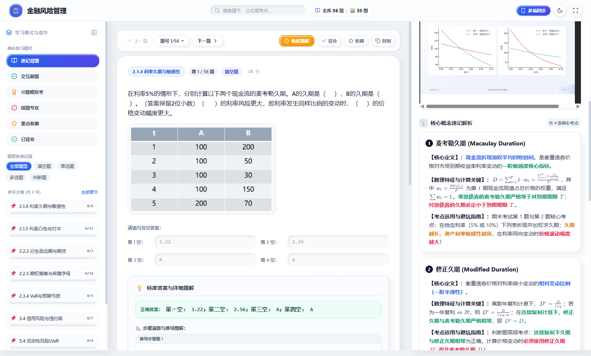

### 2. 全书公式手册注释文字多色高亮 (关键参数/正反向结论/红线区间语义彩色化)
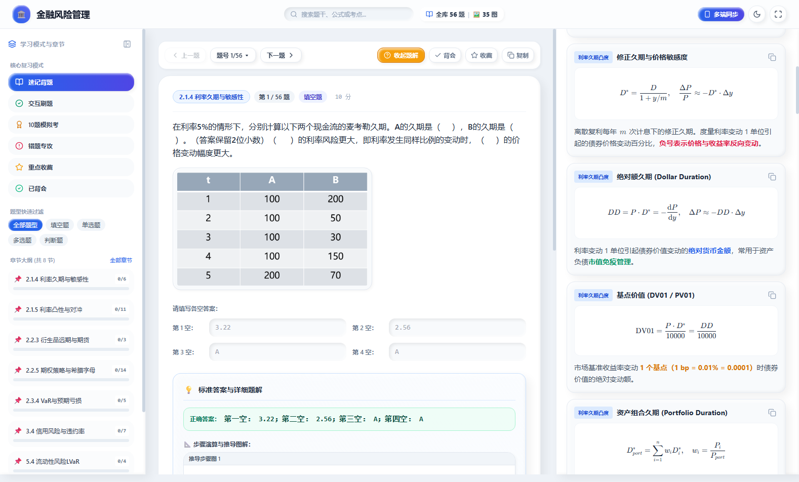

### 3. 课件 PDF 页码一键直达实机定位 (点击 P7/P11 瞬时跳至对应页，真实可用)
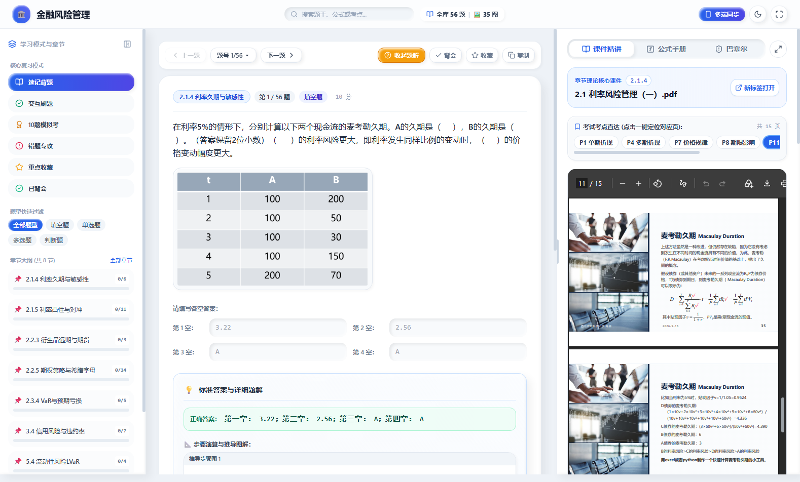

### 3. 精炼核心课件 PDF 极速秒开研读与考点直达 (剔除冗余页，15~35页秒级载入)
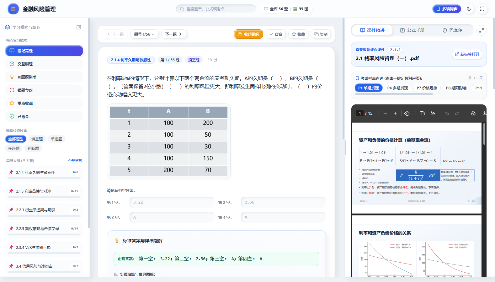

### 4. 全书公式手册 34 组计算模型与分类胶囊筛选 (严格排除第1章与第4章)
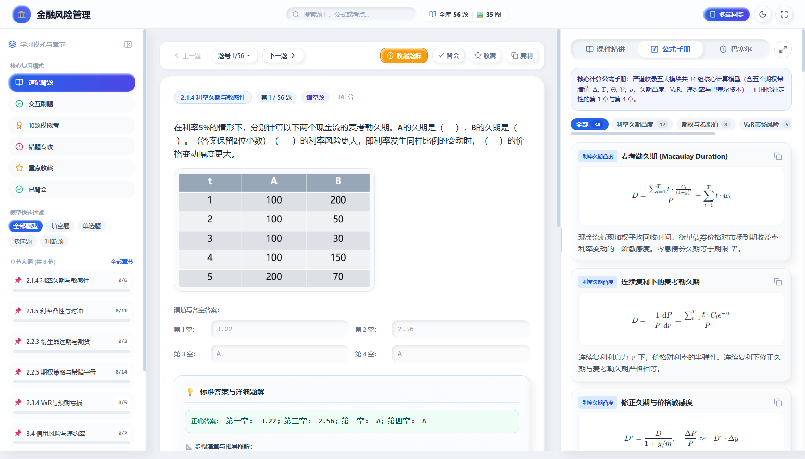

### 5. 巴塞尔协议监管备考图谱 (三支柱、资本缓冲层阶梯与防陷阱扣分清单)
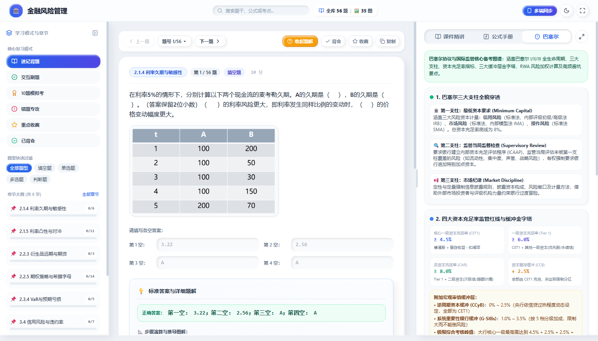

### 6. 完整课件 PDF 原生内嵌研读与一键展开半屏工作台 (最多半屏 50vw)
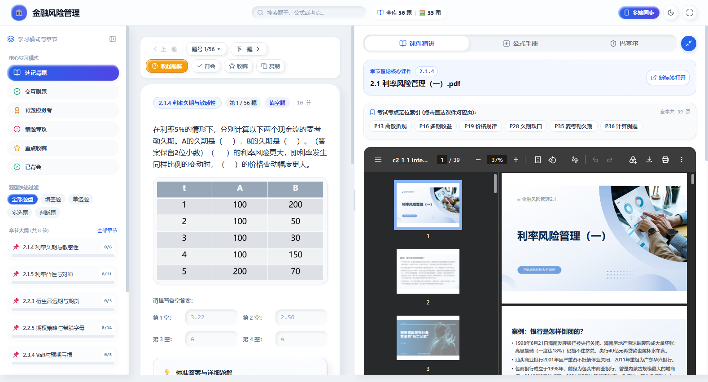

### 7. 交互刷题反复练习与重做本题体验
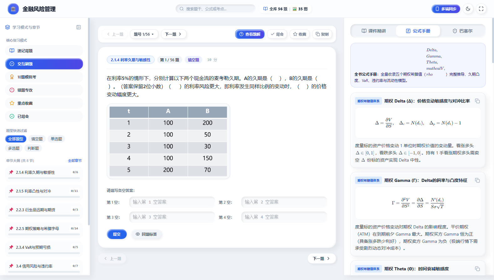

### 10. 10 题真机模拟考引擎与 20 分钟倒计时系统
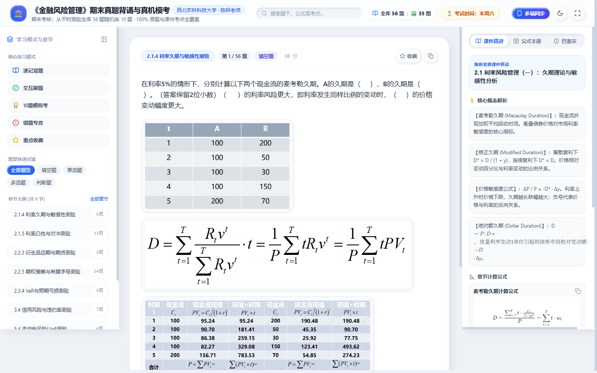

### 11. 移动端自适应竖屏界面 (手机离线随身刷题)
<div align="center">
  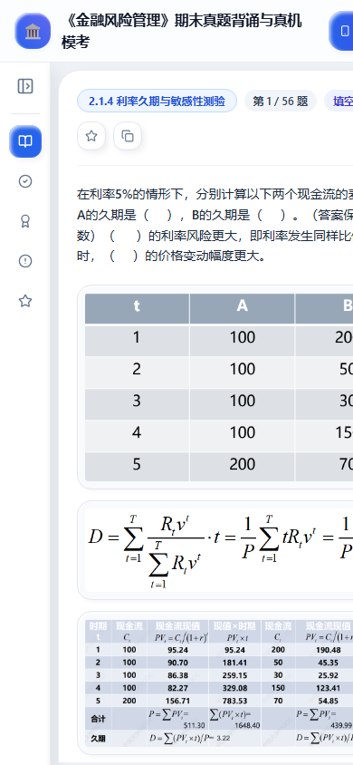
</div>

---

## 📐 系统全景架构图 (Architecture Diagram)

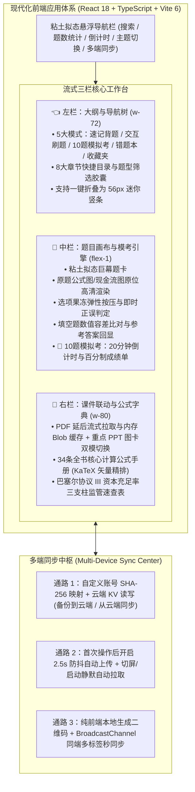

---

## 🚀 技术特性与设计亮点

1. **100% 完全复刻粘土拟态风格 (Claymorphism)**：
   - 深度继承 `muduo-study-console` 的视觉系统；
   - 拥有外凸内嵌双层漫反射阴影（`clay-card-shadow`、`clay-button-shadow`、`clay-inset-groove`、`clay-badge-shadow`）；
   - 按压触觉形变动效（`.clay-squash:active { transform: scaleX(1.03) scaleY(0.95); }`）；
   - 白天温润浅灰蓝泥质感（`#eef2f7`）与深邃哑光深色模式（`#0b0f17`）一键切换。
2. **数学公式 KaTeX 原生超清矢量排版**：
   - 告别模糊截图与纯文本伪代码；
   - 麦考勒久期 $D = \frac{\sum t \cdot CF_t / (1+y)^t}{P}$、修正久期敏感性近似 $\Delta P / P \approx -D^* \Delta y + \frac{1}{2} C (\Delta y)^2$、在险价值 $VaR$、违约概率利差公式 $PD \approx \frac{s}{1-R}$、流动性调整 $LVaR$ 均通过 KaTeX 原生渲染。
3. **10 题真机模拟考引擎**：
   - 严格对标期末机考规则：从全库 56 题中无放回随机抽取 10 题，每题 10 分，满分 100 分；
   - 20 分钟倒计时时钟，交卷后即时自动计算成绩单并归集错题。
4. **智能错题本与重点收藏**：
   - 刷题与模考中答错的题目自动归入错题本，支持掌握后单题移出；
   - 遇到计算复杂的重点题目，点击右上角星标一键收藏；
   - 数据完全保存在浏览器 `localStorage`，刷新不丢失。

---

## 🛠️ 本地开发与构建指南

### 运行环境
- Node.js >= 18.0.0
- npm >= 9.0.0

### 操作步骤
```bash
# 1. 克隆代码仓库
git clone https://github.com/Coolzs77/frm-study-console.git
cd frm-study-console

# 2. 启动本地开发热重载服务器
npm run dev

# 3. 生产打包构建
npm run build

# 4. 一键部署到 GitHub Pages
npm run deploy
```

---

## 📝 更新日志 (Changelog)

| 版本号 | 更新日期 | 更新内容概述 |
| :--- | :--- | :--- |
| **v3.7.0** | 2026-11-12 | • **彻底解决正文图片无法加载与浏览器持续转圈问题**：新增高优先级 `ResilientImage` 组件（`loading="eager"`、`fetchpriority="high"`、10 秒加载看门狗、自动带防缓存后缀重试 2 次，失败时展示可交互“重试加载”与“新标签打开原图”卡片，并统一白底防止深色模式透底失效）；待当前题目配图就绪后，轻量预加载下一题题干配图<br/>• **右侧课件 PDF 与页面加载解耦，防止占带宽阻塞正文图片**：重构 `RightSidebar.tsx` 与 `src/utils/assets.ts`，仅在桌面端可见视口 (`min-width: 1280px`) 且正文配图就绪后再启动 `fetchPdfWithProgress` 流式下载（带 22 秒卡死超时中断与实时进度条），完成后存入内存 `blob:` 缓存，点击书签跳转 `#page=N` 不再重复发起网络请求；新增【原版 PDF 课件 / 重点 PPT 图卡】双模切换，并在 PDF 超时或取消时自动展示对应章节重点 PPT 图卡<br/>• **真正可用的跨设备云端账号同步（电脑 ↔ 手机实机互通）**：基于确定性加盐 SHA-256 键映射与国内直连云端 KV 存储（`api.textdb.online`），重构 `syncService.ts` 与 `SyncModal.tsx`；提供【备份到云端】与【从云端同步】双操作按钮，点击任意一次即自动开启后续静默自动同步（2.5 秒防抖后台备份 + 打开页面/切换标签页静默自动拉取），并去除界面冗余提示文本<br/>• **资源体积大幅瘦身与前端离线化**：全部 35 张题目配图统一白底去透明通道并进行无损视觉调色盘量化压缩（`1,864 KB → 851.5 KB`，降幅 `54.3%`），全部 59 张重点 PPT 图卡优化后由 `16.19 MB` 降至 `6.59 MB`（降幅 `59.3%`）；同步弹窗改用本地 `qrcode` 库离线生成 DataURL 二维码，移除外部 `api.qrserver.com` 依赖，修复 `quizData.ts` 5 处残缺 `$` 公式定界符并开启 Vite 产物哈希防缓存 |
| **v3.6.0** | 2026-11-11 | • **彻底根除公式内部 `** **` 渲染失败 (0 星号乱码)**：数据层全面清洗 97 处误将彩色加粗包裹在 `$` 内部的遗留语法，重构为独立公式与外层样式的自然组合；并在 `MathText.tsx` 中增加预处理规整防御层，切断 KaTeX 将星号识别为乘号的链路，公式与重点文字完全纯净渲染<br/>• **56 题深度考点解析全面重塑 (逐项穿透，严禁胡编)**：20 道选择与判断题全量重写为选项级逐一辩驳解析（明确 A/B/C/D 各自对错原因），严密校准判断题正误结论与官方标答 100% 吻合（Q12对、Q13对、Q14错）；36 道计算题彻底清除“请查阅右侧课件”模板套话，补全公式定义、题给数值代入、分步算式与计算结果闭环<br/>• **多端同步体验彻底去开发化 (自定义账号名 + 静默自动同步)**：彻底移除 Gist、GitHub Token、Base64 长口令等任何技术黑话；仅需输入一个简短好记的自定义账号（如姓名拼音或学号），系统在答题/收藏时自动静默双向保存；弹窗内置实时二维码与直达链接，手机微信扫一扫屏幕即可直接在手机端打开并自动继承所有进度<br/>• **概念卡片与公式手册文字彩色高亮打磨**：对齐参考图样式，保留实心黑色圆圈序号（`❶ ❷ ❸`）与清晰圆点列表（`·`），重点文字自然采用多色加粗高亮，卡片内部坚决不嵌套多余彩色边框，公式手册注释文本同步高亮 |
| **v3.5.0** | 2026-11-11 | • **彻底剥除冗余嵌套彩色外框**：对标用户参考图（“官方备考实战技巧”），移除所有内嵌背景框（`bg-slate-50` / `bg-emerald-50` / `bg-amber-50`），重构为单一白底/深色卡片，顶部配备纯黑色实心圆形序号标（`❶`、`❷`、`❸`），正文采用整洁的圆点引导列表，回归通透纯粹的阅读体验<br/>• **重点文字直接多色加粗高亮**：升级 `MathText.tsx` 正则词法引擎，原生支持 `**[color:text]**` 语义色彩标签（蓝色表核心术语定义、绿色表数理特征与恒等式、琥珀色表警戒门槛与条件、玫瑰红表扣分陷阱与损失敞口），并支持内部递归解析 KaTeX 行内公式，告别全篇纯黑压抑感<br/>• **全书公式手册注释文字全面多色化**：对 `FORMULA_DICT` 全量 34 组核心计算模型的中文说明注释（`desc` / `usage`）进行语义色彩升级，关键参数、正反向关系、破产临界值与资本红线全部赋予鲜明色彩<br/>• **部署管道增量优化 (Delta Push)**：重构部署脚本为拉取最新远端分支再增量推送，将每次更新推送体积从 225MB 骤降至 696KB，部署耗时压缩至 8 秒 |
| **v3.4.0** | 2026-11-11 | • **核心概念三段式多色语义卡片重构**：彻底告别单一黑字与视觉疲劳，将全书 33 条概念重构为独立多色卡片（含编号徽章、冷灰蓝【核心定义】、翡翠绿【数理特征与计算关键】、暖琥珀【考点运用与避坑指南】），各部分层级鲜明<br/>• **深度修复 Markdown 语法与嵌套公式渲染**：升级 `MathText.tsx` 正则词法解析器，支持 Markdown `**...**` 粗体内部嵌套 KaTeX 行内公式，彻底消除原始 `**` 星号乱码泄露<br/>• **课件 PDF 页码一键直达彻底修复 (真实可用)**：攻克 Chromium 内置 PDF 插件对已有 iframe 纯 hash 变更 (`#page=N`) 静默忽略的业界经典缺陷，采用动态 Key 与查询参数重定向机制（`?p=N#page=N`），实现点击 P1、P4、P7、P11、P14 瞬时精准跳转对应幻灯片 |
| **v3.3.0** | 2026-11-11 | • **精炼核心课件 PDF 极速加载**：剔除原版 PPT 中的引入故事、课外案例与过渡页，各章页数从 60~92 页精简至 15~35 页，体积减少超 70%，消除内嵌 iframe 载入延迟，并重新校准全部真题考点书签直达页码<br/>• **核心概念速记解析换行分段**：彻底重排全书 32 条核心概念，拆解为【核心定义】、【数理特征与计算关键】、【考点运用与避坑指南】三个语义段落，解决单一段落文本拥挤问题<br/>• **全书计算公式手册做全做精**：全量扩充并严谨校对 34 组核心计算公式模型，上线 5 大分类胶囊过滤条（利率久期凸度 12 组、期权与希腊值 8 组、VaR市场风险 5 组、信用风险 5 组、流动性与资本 4 组），严格排除纯定性的第 1 章与第 4 章公式<br/>• **巴塞尔协议全景监管备考图谱**：升级巴塞尔面板为五大结构化学习模块（三支柱体系、资本充足率红线与多层缓冲层、三大风险 RWA 计量层级、流动性双指标与杠杆率、期末易错陷阱与扣分防线） |
| **v3.2.0** | 2026-11-11 | • **完整原版课件 PDF 深度内嵌**：全套 14 份课件（含 2.3 与 2.5 pptx 导出）全面转为高质量矢量 PDF 原生嵌入，支持缩放、滚动翻页、目录书签与新标签页全屏研读<br/>• **右侧栏自由拖拽与一键展开半屏**：左边缘配备拖拽把手（支持在 360px 至 50vw 自由拖动并持久化宽度），顶部配备一键半屏展开按钮（严格限制最大宽度为 50vw，左右视窗均衡）<br/>• **高频考点页码一键直达**：顶部配备 P13、P16、P28、P35 等考点快速直达胶囊，点击一秒切换定位至课件指定页<br/>• **公式手册五个希腊值符号严谨修正**：彻底消除多重转义缺陷，精准呈现纯正希腊符号 $\Delta, \Gamma, \Theta, \mathcal{V}, \rho$ |
| **v3.1.0** | 2026-11-11 | • 课件精讲重构为**内嵌核心课件研读面板**：剔除引入废话与案例，精选 42 页核心考点原版课件，支持快捷上下翻页、页码直达缩略栏与原画灯箱<br/>• 攻克公式手册白屏崩溃异常（修复 JSX 变量解析缺陷，全量兼容 usage 与 desc，外层 ErrorBoundary 熔断防护）<br/>• 交互刷题模式解除提交后输入封锁，支持持续改选改填并新增专属【重做本题】一键重置按钮<br/>• 答案解析排版重构：支持换行段落化，清晰拆分为思路、推导步骤与结论归纳，杜绝单一大段文字墙<br/>• 顶栏极简收敛为“🏛️ 金融风险管理”，章节大纲剔除“测验”字样并上线动态背会进度条，全量收录五个期权希腊值体系 |
| **v1.1.0** | 2026-11-11 | • 顶栏与全站标题降噪精简，彻底去除多余修饰与冗余文本<br/>• 做题图与推导图物理隔离，彻底去除悬浮暗色遮罩与遮挡文字<br/>• 导航控制栏置顶（上一题/下一题/题号跳转一键直达，免滚轮滑动）<br/>• 仿代码随想录独立题解抽屉与 1:1 标准答案原汁回显<br/>• 修复交互刷题提交后答案显示覆盖缺陷<br/>• 课件精讲与核心概念解析全面支持行内 KaTeX 公式精排与重点加粗，嵌入精选重点 PPT 核心页码卡片 |
| **v1.0.0** | 2026-11-11 | • 现代化前端架构全栈搭建（Vite 6 + React 18 + TS + Tailwind CSS + KaTeX）<br/>• 100% 完全复刻粘土拟态风格与流式三栏式布局<br/>• 56 道原题与 35 张高清原图全量集成，公式全部标准化为 LaTeX<br/>• 实装 10 题真机模拟考、错题本与收藏夹系统<br/>• 实装手机/电脑多端数据同步中心（口令快传 / Gist / 文件备份）<br/>• 自动部署上线至 GitHub Pages |
