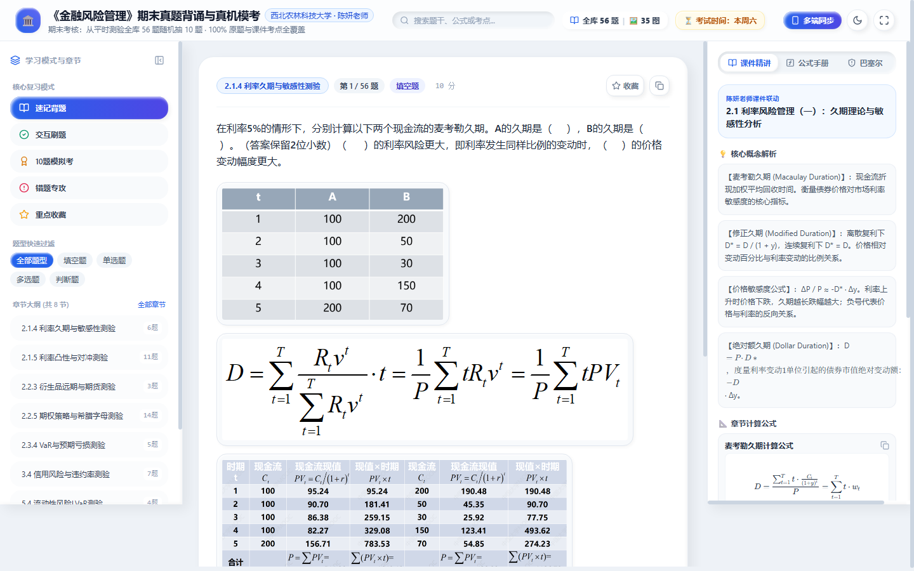
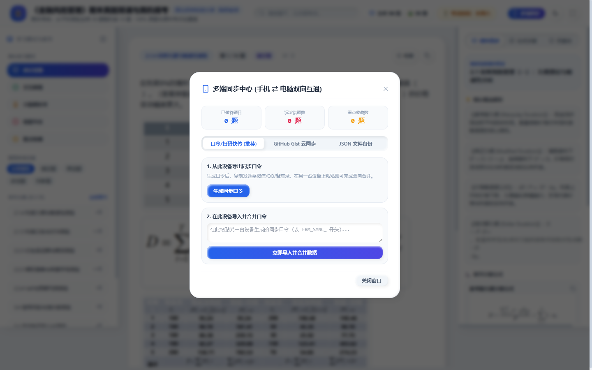
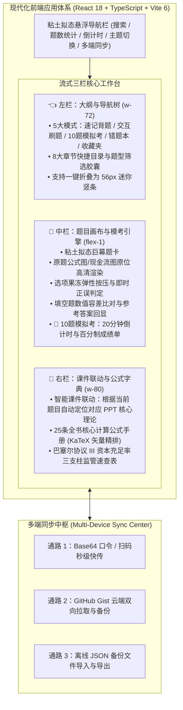

# 《金融风险管理》期末真题背诵与真机模考控制台 (FRM Study Console)

[](https://react.dev/)
[](https://vitejs.dev/)
[](https://www.typescriptlang.org/)
[](https://tailwindcss.com/)
[](https://katex.org/)
[](LICENSE)
[](https://coolzs77.github.io/frm-study-console/)

> 专为第二学位《金融风险管理》（西北农林科技大学经管学院，陈妍副教授主讲）期末机考打造的现代化单页面复习工作台。收录平时全部 8 份章节测验共 56 道原题与 35 张原题高清公式图，深度融合课件核心理论与推导公式，提供考前速记、交互刷题、10 题真机模拟考、手机/电脑多端无缝同步功能。

---

## 🌟 在线访问与移动端使用

- **生产站点地址**：👉 [https://coolzs77.github.io/frm-study-console/](https://coolzs77.github.io/frm-study-console/)
- **多端适配**：适配电脑大屏（三栏流式工作台）、平板横屏与手机端（单栏流式抽屉）。
- **手机/电脑数据同步**：在电脑端做完题或标记错题后，点击右上角【多端同步】生成同步码，手机端粘贴同步码即可 1 秒双向同步错题本与收藏记录。

---

## 📸 实机界面全景图集 (Live Visual Showcase)

### 1. 电脑端流式三栏工作台与 KaTeX 矢量公式精排 (白昼拟态)


### 2. 深邃哑光夜间模式与粘土边缘柔光 (深色拟态)


### 3. 10 题真机模拟考引擎与 20 分钟倒计时系统


### 4. 手机与电脑多端数据同步中枢 (口令快传 / Gist 云同步 / 离线备份)


### 5. 移动端自适应竖屏界面 (手机离线随身刷题)
<div align="center">
  
</div>

---

## 📐 系统全景架构图 (Architecture Diagram)



---

## 🚀 技术特性与设计亮点

1. **100% 完全复刻粘土拟态风格 (Claymorphism)**：
   - 深度继承 `muduo-study-console` 的视觉系统；
   - 拥有外凸内嵌双层漫反射阴影（`clay-card-shadow`、`clay-button-shadow`、`clay-inset-groove`、`clay-badge-shadow`）；
   - 按压触觉形变动效（`.clay-squash:active { transform: scaleX(1.03) scaleY(0.95); }`）；
   - 白天温润浅灰蓝泥质感（`#eef2f7`）与深邃哑光深色模式（`#0b0f17`）一键切换。
2. **数学公式 KaTeX 原生超清矢量排版**：
   - 告别模糊截图与纯文本伪代码；
   - 麦考勒久期 $D = \frac{\sum t \cdot CF_t / (1+y)^t}{P}$、修正久期敏感性近似 $\Delta P / P \approx -D^* \Delta y + \frac{1}{2} C (\Delta y)^2$、在险价值 $VaR$、违约概率利差公式 $PD \approx \frac{s}{1-R}$、流动性调整 $LVaR$ 均通过 KaTeX 原生渲染。
3. **10 题真机模拟考引擎**：
   - 严格对标期末机考规则：从全库 56 题中无放回随机抽取 10 题，每题 10 分，满分 100 分；
   - 20 分钟倒计时时钟，交卷后即时自动计算成绩单并归集错题。
4. **智能错题本与重点收藏**：
   - 刷题与模考中答错的题目自动归入错题本，支持掌握后单题移出；
   - 遇到计算复杂的重点题目，点击右上角星标一键收藏；
   - 数据完全保存在浏览器 `localStorage`，刷新不丢失。

---

## 🛠️ 本地开发与构建指南

### 运行环境
- Node.js >= 18.0.0
- npm >= 9.0.0

### 操作步骤
```bash
# 1. 克隆代码仓库
git clone https://github.com/Coolzs77/frm-study-console.git
cd frm-study-console

# 2. 启动本地开发热重载服务器
npm run dev

# 3. 生产打包构建
npm run build

# 4. 一键部署到 GitHub Pages
npm run deploy
```

---

## 📝 更新日志 (Changelog)

| 版本号 | 更新日期 | 更新内容概述 |
| :--- | :--- | :--- |
| **v1.0.0** | 2026-11-11 | • 现代化前端架构全栈搭建（Vite 6 + React 18 + TS + Tailwind CSS + KaTeX）<br/>• 100% 完全复刻粘土拟态风格与流式三栏式布局<br/>• 56 道原题与 35 张高清原图全量集成，公式全部标准化为 LaTeX<br/>• 实装 10 题真机模拟考、错题本与收藏夹系统<br/>• 实装手机/电脑多端数据同步中心（口令快传 / Gist / 文件备份）<br/>• 自动部署上线至 GitHub Pages |
